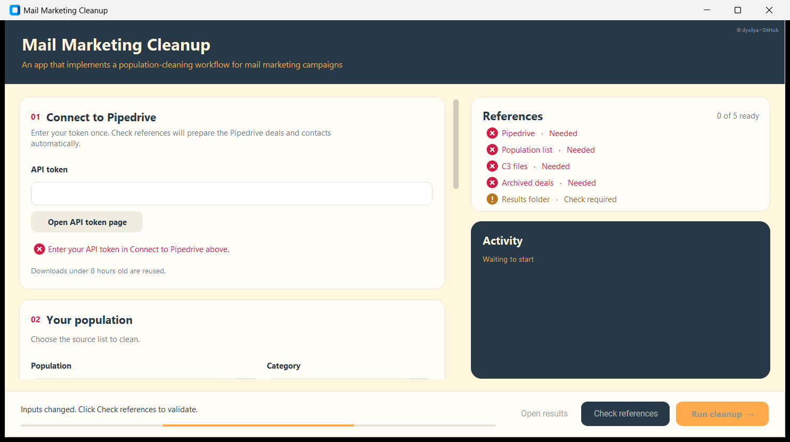
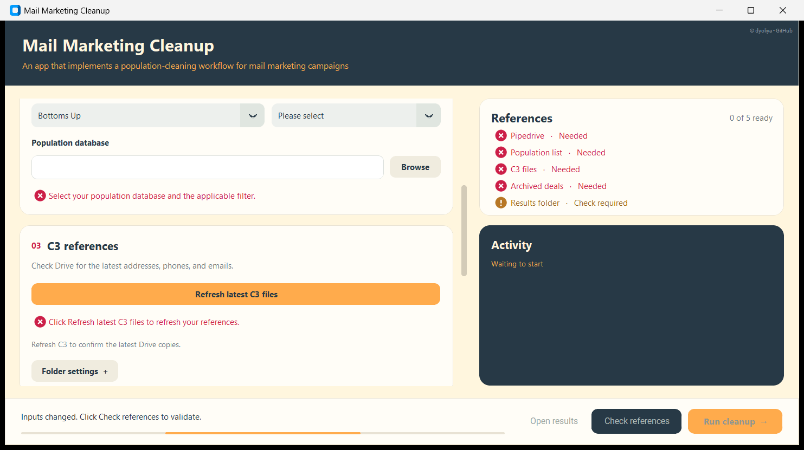
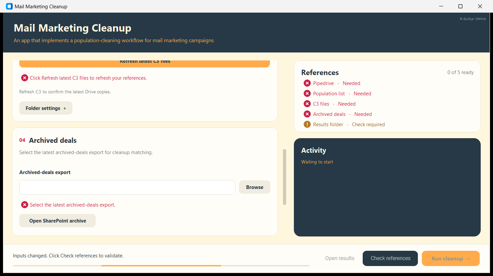
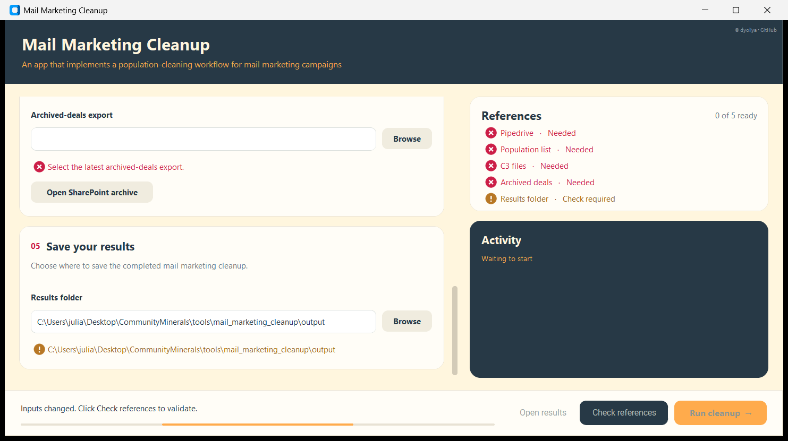

# Mail Marketing Cleanup Tool

**Mail Marketing Cleanup Tool** is a desktop utility (built with Python) that implements a **controlled population-cleaning workflow** for mail marketing campaigns.

It takes a mailing population (Bottoms Up, NCOP, Pooling Order, NTM, or a Pipedrive-driven Conversion Campaign list), cross-checks every record against the company's current and archived Pipedrive deals/contacts and the "C3" opt-out/suppression register (address, phone, email), and tags each record clean or excluded — with a full, explainable audit trail — before it is sent to a mail house.

---


---

## 🚧 Problem Statement / Motivation

Every mail marketing drop starts from a population list — Bottoms Up owners, NCOP owners/heirs, a Pooling Order list, NTM, or a Pipedrive-driven campaign filter — that has to be checked against several other sources before a single letter goes out: is the Mineral Owner already in an active Pipedrive deal, were they in a past (archived) deal, and have they opted out of direct mail, phone, or email contact through the "C3" suppression lists?

Doing that cross-referencing by hand, record by record, against live Pipedrive data, a SharePoint archive export, and three separate opt-out files is slow and error-prone at volume, and a missed match means mailing someone who should have been excluded — with no record of why a record was kept or dropped.

To close this gap, a repeatable cleanup pipeline is required: one that pulls in all reference sources, matches every record against them by multiple fields, tags each record clean or excluded, and leaves a clear audit trail for manual review.

Mail Marketing Cleanup Tool addresses this by enforcing a controlled cleanup pipeline:
1. Load the selected population (local SQLite database, Pipedrive filter download, or manual export).
2. Load reference data: current Pipedrive deals/contacts, an archived-deals export, and the C3 opt-out lists (address, phone, email).
3. Normalize phone numbers and mailing addresses, then match each population record against every reference source by phone, address, deal title, contact group, and population-specific ID.
4. Tag each record `clean_tag = Y` (safe to mail) or `N` (excluded), recording a plain-English reason for every match.
5. Write the tagged population plus a full match-evidence audit sheet, a run summary, and an activity log to a dedicated output folder.

---

## ✨ Features
- **Multiple population types**, each with its own validation/execution handler: **Bottoms Up** (by category), **NCOP** (by Original Owners/Heirs/Both scope), **Pooling Order**, **NTM** (by output counties/states), and several Pipedrive-filter-driven **Conversion Campaign** and **Recycled** lists. (**Deceased Owners (DEO)** is registered but not yet implemented.)
- **Live Pipedrive API sync**: Pipedrive deals and contacts are downloaded directly via the API (cursor-paginated, retried on throttling/server errors) and cached per token/filter for 8 hours to avoid redundant calls. (Manual CSV/XLSX upload for Pipedrive data exists in the code but is currently disabled.)
- **Multi-source matching**: checks each record's normalized phone number, normalized mailing address, deal title (substring matching), and population-specific IDs (Bottoms-Up/NCOP/Pooling Order/Unique Database ID, Serial Number, Contact Group ID) against current Pipedrive deals/contacts, an archived-deals export, and the C3 opt-out register.
- **Address normalization**: USPS-style abbreviation normalization (e.g. ROAD → RD, STREET → ST, NORTH → N), ZIP trimming, and alphanumeric-only canonicalization for reliable address matching.
- **ZIP/postal code formatting**: `Input: Zip Code`, `input_postalcode`, and `md_postalcode` are always written to the output as text — never as a float with a trailing `.0`.
- **C3 suppression sync**: one-click refresh of the latest address/phone/email opt-out files from a shared Google Drive folder via a service account, with a local hash/stamp cache so unchanged files aren't re-downloaded.
- **Group-aware de-duplication** by `contact_group_id`, with detection of conflicting matches within the same contact group.
- **Full audit trail**: a secondary "Match Details" sheet lists exactly which reference record (Pipedrive deal, C3 row, etc.) triggered each exclusion, alongside a human-readable `reason_for_removal` on every row.
- **Safe, resumable runs**: each run writes to its own timestamped output folder with an `INCOMPLETE.txt` marker that is only removed once the run finishes successfully.
- **Run reporting**: every run produces a `summary.json` (row counts, clean/excluded counts, source file fingerprints) and a full `activity.log`.
- **Operator-friendly desktop UI** with a step-by-step wizard, a readiness checklist, and a live activity log, packaged as a standalone Windows executable via PyInstaller.

---

## 🧠 Logic Flow

1. User selects a **population**: Bottoms Up, NCOP, Pooling Order, NTM, or a Conversion Campaign/Sales Recycled list, along with its category/scope/filter and source (local SQLite database, Pipedrive filter download, or manual file).
2. App loads **reference data**:
   - Current open Pipedrive deals and persons, via live API download.
   - The archived-deals export (SharePoint), joined to persons.
   - The three **C3 opt-out files** (Addresses, Phones, Emails), either refreshed from Google Drive or supplied locally. Only rows whose `OPT-OUT_MEDIUM` is exactly `Direct Mail`, `Mailing Address`, `Phone`, or `Email` are treated as opt-outs — any other value (or a blank) is ignored for suppression purposes.
3. Every record is normalized (phone digits-only, address to a USPS-style standard form) and checked against those references using the **population-specific rules below**. A record is tagged `clean_tag = 'N'` (excluded) the moment **any one** rule matches, with every matched rule recorded in `reason_for_removal`; a record with no match at all is tagged `clean_tag = 'Y'` (safe to mail). As a final step, after all matching and group exclusion, any record still tagged `Y` without a usable mailing address is tagged `N` with the reason "No valid mailing address (street, city, state)". Values such as `NAN`, `NONE`, `NULL`, `N/A`, and `UNKNOWN` count as blank.
4. Writes the result to `output/run_<timestamp>/`:
   - One or more `.xlsx` files (split at Excel's row limit) with a **Cleanup** sheet (original columns + `clean_tag` + `reason_for_removal`) and a **Match Details** sheet.
   - `summary.json` with run metrics and source-file fingerprints.
   - `activity.log` with the full run log.
   - An `INCOMPLETE.txt` marker that is deleted once the run completes without error.

### What gets a record tagged `N` (excluded), by population

**Bottoms Up** — a record is excluded if ANY of the following matches, checked against **both** current Pipedrive and the archive:
- Phone number (any of up to 5 phone fields) matches a Pipedrive contact's phone.
- Mailing address matches a Pipedrive contact's mailing address (checked both as the "owner-reported" address and the "mail-deliverable/standardized" address).
- The generated deal title (owner name + county/state) matches an existing Pipedrive deal title.
- Serial Number matches a Pipedrive deal's Serial Number.
- Contact Group ID matches a Pipedrive deal's Contact Group ID.
- Bottoms Up Database ID matches a Pipedrive deal's BU Database ID.
- Mailing address or phone number appears in the **C3 opt-out list**.

In addition: if any record in a given Contact Group ID matched one of the rules above, every other record in that same group is also excluded ("Conflicting group match"), even if that record had no match of its own — and only one row per Contact Group ID is kept in the final output (a row with a valid mailing address is preferred; among those, whichever comes first in load order).

Finally, a record still tagged `Y` is tagged `N` ("No valid mailing address") if neither its owner-reported address (`Input: Address`/`Input: City`/`Input: State`) nor its skip-traced address (`md_address`/`md_city`/`md_state`) has a street, city, and state all filled in.

**NCOP** — a record is excluded if:
- It already has a Pipedrive Deal ID on file ("Existing Deal ID in NCOP") — checked before anything else.
- Otherwise, its deal title, mailing address, phone number, Serial Number, or NCOP ID matches current or archived Pipedrive (address and phone are also checked against **C3**).
- Email is **not** checked for NCOP.
- **Company/Religious Institution pre-filter**: records whose `contact_type` is `COMPANY` or `RELIGIOUS INSTITUTION` (case/whitespace-insensitive, exact match) are dropped from the population at selection time, before any matching runs — they never appear in the output at all, excluded or otherwise.
- A record with no other match is tagged `N` ("No valid mailing address") if none of its three address sets has a street, city, and state all filled in.
- When scope is **Both**, the run writes two separate output files — one for Original Owners, one for Heirs — each written even if it ends up with zero rows.

**Pooling Order** — same rule set and order as NCOP (existing Deal ID first, then deal title / address / phone / Serial Number / Pooling Order ID against current + archived Pipedrive, address and phone also checked against C3). Email is **not** checked. Same **Company/Religious Institution pre-filter** as NCOP applies, on `contact_type`. A record with no other match is tagged `N` ("No valid mailing address") if neither of its two address sets has a street, city, and state all filled in.

**NTM** — a record is excluded if its deal title, mailing address, phone number, Serial Number, or Unique Database ID matches current or archived Pipedrive (address and phone also checked against C3). In addition, **all records sharing the same Contact ID are excluded together**: if one record in the group matches, every record in that group is tagged `N`, and only one record per group is kept in the selected county/state output — a row with a valid mailing address is preferred, then the lowest numeric `id`. If the kept record is still tagged `Y` but neither its owner-reported (`input_*`) nor mail-deliverable (`md_*`) address has a street, city, and state all filled in, it is tagged `N` ("No valid mailing address"). Email is **not** checked. Same **Company/Religious Institution pre-filter** as NCOP applies, on `contact_type`. Group matching and exclusion are computed across **all** of a contact's eligible counties/states, not just the ones selected for the current run — so a record can be excluded because of a match tied to a county/state you didn't select for this mailing.

**Conversion Campaign / Sales Recycled lists** (Prio 2/3/4, JR/Mid/SR AA Sales Recycled) — these populations ARE Pipedrive deals, so each record is checked against every *other* Pipedrive deal (its own deal is excluded from the comparison) plus the archive:
- Mailing address, phone number, **and email** (the only population type where email is checked) match another deal's contact info, or appear in **C3** (address, phone, and email are all checked against C3 for this population).
- BU Database ID, NCOP ID, Unique Database ID, Pooling Order ID, Contact Group ID, or Serial Number matches another deal's corresponding ID.
- There is no Contact Group/Contact ID group-exclusion step for this population — each deal is judged independently.
- A deal with no other match is tagged `N` ("No valid mailing address") if `Person - Mailing Address` is blank.

#### Name(s) used to build the "deal title" for matching

The generated deal title referenced above isn't built from the same name field the same way in every population:

| Population | Name(s) used in the generated title |
|---|---|
| Bottoms Up | `First Name` + `Last Name` if `Last Name` is present; otherwise falls back to `Owner` alone. Only one title is generated per record — never both. |
| NCOP | `owner_name`, **and** `First Name` + `Last Name` as a second candidate when both are present — a match on either counts. |
| Pooling Order | `lessor_owner`, **and** `First Name` + `Last Name` as a second candidate when both are present (same logic as NCOP). |
| NTM | `full_name`, **and** `First Name` + `Last Name` as a second candidate when both are present (same logic as NCOP). |
| Conversion Campaign / Sales Recycled | No deal-title matching is done for this population at all. |

### Required reference columns (regardless of population)

Every run validates the Pipedrive data and the archived-deals export up front and fails fast, with a clear error, if a required column is missing. The columns below are required **no matter which population you're cleaning** — each population's rules (above) then add on top of this common set.

**From Pipedrive** — the app downloads deals/persons live via the API and builds its own working columns from the raw response. These are the exact columns the matching logic (and the `pipedrive_cache/` snapshot files) actually use, for every population:
- Deals: `Deal - ID`, `Deal - Title`, `Deal - Contact Group ID`, `Deal - Serial Number`, `Deal - BU Database ID`, `Deal - NCOP ID`, `Deal - Pooling Order ID`, `Deal - Unique Database ID`
- Persons: `Person - ID`, `Person - Mailing Address`, `Person - Phone - Work`, `Person - Phone - Home`, `Person - Phone - Mobile`, `Person - Phone - Other`, `Person - Email - Home`, `Person - Email - Other`, `Person - Email - Work`

For these to populate correctly, your Pipedrive account must have **custom fields named exactly** (without the `Deal - `/`Person - ` prefix — the app adds that itself when building the columns above): `Contact Group ID`, `Serial Number`, `BU Database ID`, `NCOP ID`, `Pooling Order ID`, `Unique Database ID` on **Deals**, and `Mailing Address` on **Persons**. Title, ID, phone, and email are standard Pipedrive fields and need no extra setup.

**From the archived-deals export (SharePoint)** — unlike the Pipedrive columns above, this file must use **bare, unprefixed** headers (the app renames them internally to line up with the Pipedrive columns):
- `ID` (or `Deal ID`)
- `Title`
- `Serial Number`
- `Contact person ID`

Each population also requires its own ID column in the archive, in addition to the four above:

| Population | Additional required archive column(s) |
|---|---|
| Bottoms Up | `Contact Group ID`, `BU Database ID` |
| NCOP | `NCOP ID` |
| Pooling Order | `Pooling Order ID` |
| NTM | `Unique Database ID` |
| Conversion Campaign / Sales Recycled | `Contact Group ID`, `BU Database ID`, `NCOP ID`, `Pooling Order ID`, `Unique Database ID` |

> If any of these columns are missing, the run stops before any matching begins and reports which one — select the latest full archive export (or check your Pipedrive field setup) and try again.

### Required population-source columns, by population

Each population's own source (the local database table, or the uploaded export for Conversion Campaign) is also validated up front against a fixed column list — a run won't start if any are missing, except for the columns marked **optional** below, which aren't required and are simply carried through to the output when present.

**Bottoms Up** (`bottoms_up` table):
`id`, `Category`, `contact_group_id`, `Serial Number`, `Owner`, `First Name`, `Middle Name`, `Last Name`, `County`, `State`, `Input: Address`, `Input: City`, `Input: State`, `Input: Zip Code` (optional), `md_address`, `md_city`, `md_state`, `phone1`–`phone5`

**NCOP** (`ncop` table):
`ncop_id`, `is_original`, `contact_type`, `deal_id`, `serial_number`, `first_name`, `last_name`, `owner_name`, `combined_county`; three address sets — `address`/`city`/`state`, `address2`/`city2`/`state2`, `add_address1`/`add_address1_city`/`add_address1_state`; phones `cleaned_phone1`–`cleaned_phone4` and `phone_1`–`phone_5`

**Pooling Order** (`pooling_order` table):
`po_id`, `contact_type`, `deal_id`, `serial_number`, `lessor_owner`, `first_name`, `last_name`, `target_county`, `target_state`; two address sets — `address`/`city`/`state` and `add_address1`/`add_address1_city`/`add_address1_state`; phones `ph_phone1`–`ph_phone5`

**NTM** (`ntm` table):
`id`, `contact_id`, `full_name`, `first_name`, `middle_name`, `last_name`, `contact_type`, `target_county`, `target_state`, `serial_number`, `old_serial_number`; raw address `input_address`/`input_city`/`input_state`/`input_postalcode` (optional); `md_address`/`md_city`/`md_state`/`md_postalcode` (optional); phones `phone1`–`phone6`

**Conversion Campaign / Sales Recycled** (uploaded export, or the live Pipedrive download when using that source):
`Deal - ID`, `Deal - Title`, `Deal - Pipeline`, `Deal - Stage`, `Deal - Owner`, `Deal - Value`, `Deal - Deal created`, `Deal - Deal Status`, `Deal - Deal Summary`, `Deal - Unique Database ID`, `Deal - BU Database ID`, `Deal - NCOP ID`, `Deal - Pooling Order ID`, `Deal - Contact Group ID`, `Deal - Serial Number`, `Deal - Contact person`, `Deal - County`, `Deal - County (Old)`, `Deal - Last RVM Date`, `Deal - Marketing Medium`, `Person - Mailing Address`, `Person - Phone - Home`, `Person - Phone - Mobile`, `Person - Phone - Other`, `Person - Phone - Work`, `Person - Email - Home`, `Person - Email - Other`, `Person - Email - Work`. Of these, only the ID columns, `Deal - Title`, the address, and the phone/email columns feed the matching rules above — the rest (pipeline, stage, owner, value, dates, etc.) are carried through for display only.

---

## 📝 Requirements
- **Python**: 3.11+ recommended.
- **Services**:
  - A **Pipedrive API token**, required to connect to Pipedrive (currently the only supported mode — manual upload of Pipedrive data is disabled).
  - A **Google Cloud service account** with Drive read-only access, required only for refreshing the C3 opt-out files from Google Drive.
- **Local configuration** (not included in the repo — must be supplied per environment):
  - `config/endpoints.json` (copy from `config/endpoints.example.json`), containing `pipedrive_domain`, `archive_url` (SharePoint archive link), and `c3_drive_folder_id`.
  - `config/google_service_account.json` — the Google service-account key, if using Google Drive C3 sync.
- **Python packages**: see `requirements.txt` (UI: `customtkinter`, `pillow`; data: `pandas`, `numpy`, `openpyxl`, `xlsxwriter`, `xlrd`, `pyahocorasick`; Google Drive: `google-api-python-client`, `google-auth` and related packages; HTTP: `requests`).

> Install all pinned dependencies from `requirements.txt`.

## ⚠️ Manual Pre-requisites (Current Process)

Before running the tool to clean a population, the following must be in place:

1. **`config/endpoints.json`** must exist with valid values (copy `config/endpoints.example.json` and fill in your company's Pipedrive domain, SharePoint archive URL, and C3 Google Drive folder ID).
2. **A Pipedrive API token** on hand — manual upload of Pipedrive deal/person exports exists in the code but is currently disabled.
3. **The archived-deals export** downloaded from SharePoint (there is a link to the archive in the UI, but no automatic download).
4. **(Google Drive C3 sync only)** `config/google_service_account.json` present, with the target Drive folder shared with that service account's email.

---

## 🚀 Installation and Setup
1. **Clone repository**
    ```bash
    git clone https://github.com/dyoliya/mail_marketing_cleanup.git
    cd mail_marketing_cleanup
    ```

2. **Install dependencies**
    ```bash
    pip install -r requirements.txt
    ```

3. **Folder Structure**

    <pre>project/
    │
    ├── mail_marketing_ui.py            Main application entry point (GUI)
    ├── mail_marketing_cleanup.py       Backend: reference loading, API/cache, matching rules, output writing
    ├── requirements.txt
    ├── version.txt
    ├── config/
    │   ├── endpoints.example.json      Template (committed)
    │   └── endpoints.json              Real values: pipedrive_domain, archive_url, c3_drive_folder_id (local only)
    │   └── google_service_account.json Google service account credentials (local only)
    ├── c3/                             Local cache of C3 opt-out files synced from Google Drive (local only)
    ├── pipedrive_cache/                Cached Pipedrive API downloads, per token/filter (local only)
    └── output/
        └── run_YYYYMMDD_HHMMSS_ffffff/ One folder per cleanup run (auto-created)
    </pre>

    Everything under `config/` (except `endpoints.example.json`), `c3/`, `pipedrive_cache/`, and `output/` is environment-specific data and is excluded from version control via `.gitignore`.

4. **Set Up Configuration**

    4.1. **Endpoints**
    - Copy `config/endpoints.example.json` to `config/endpoints.json`.
    - Fill in `pipedrive_domain`, `archive_url` (your SharePoint archive link), and `c3_drive_folder_id` (your Google Drive C3 folder).

    4.2. **Pipedrive API Token** (required for API mode)
    - Generate a personal API token from your Pipedrive account settings.
    - Enter it in the app's "Connect to Pipedrive" step.

    4.3. **Google Service Account** (required for C3 auto-refresh)
    - In Google Cloud Console, create (or reuse) a service account and download its JSON key.
    - Save it as `config/google_service_account.json`.
    - Share the C3 Google Drive folder with the service account's `client_email` address.

## 🖥️ User Guide

### App walkthrough

The app is a single scrollable window: five numbered input panels on the left, a live **References** checklist and **Activity** log on the right, and a status bar with the **Open results / Check references / Run cleanup** buttons fixed at the bottom.

**Panels 01–02 — Connect to Pipedrive, Your population**

- **01 Connect to Pipedrive**: where you paste your Pipedrive API token. This is the only reference source the app pulls live — everything else below is a file you point it to.
- **02 Your population**: pick the population type (Bottoms Up, NCOP, Pooling Order, NTM, or a Conversion Campaign) and its category/scope/filter, then the source file or database for that population.
- **References** (right): a live readiness checklist for all five inputs — turns from "Needed" to ready once each one is validated.
- **Activity** (right): the full log of what the app is doing, updated as you work.

**Panel 03 — C3 references**

- One-click **Refresh latest C3 files** pulls the latest address/phone/email opt-out lists from the shared Google Drive folder; **Folder settings** lets you point to a local copy instead.

**Panel 04 — Archived deals**

- Point this at your SharePoint archived-deals export; **Open SharePoint archive** opens the source link if you still need to download it.

**Panel 05 — Save your results**

- Choose the output folder. The status bar at the bottom (visible in every panel) shows what's still needed, and is where you'll click **Check references** and then **Run cleanup →** once all five panels are ready.

### A. First-time preparation
1. Open the project folder.
2. Confirm `config/endpoints.json` exists with valid values.
3. Confirm `config/google_service_account.json` exists (if you'll refresh C3 from Google Drive).
4. Have your Pipedrive API token ready.

### B. Clean a population
1. Launch the app (`python mail_marketing_ui.py`, or the compiled executable).
2. **Connect to Pipedrive**: enter your API token.
3. **Your population**: choose the population type (Bottoms Up, NCOP, Pooling Order, NTM, or a Conversion Campaign), its category/scope/filter, and its source (local database, Pipedrive filter, or manual file).
4. **C3 references**: click **Refresh latest C3 files** to sync from Google Drive, or point to a local folder.
5. **Archived deals**: upload the SharePoint archive export file.
6. **Save your results**: choose an output folder.
7. Click **Check references** to validate everything is in place, then **Run cleanup →**.
8. Watch the **Activity Log** for progress through loading, normalization, matching, and output writing.

### C. Review outputs
- Once the run completes, click the **Open results** button to open its `output/run_<timestamp>/` folder directly.
- Open the generated `.xlsx` in that folder — only rows with `clean_tag = Y` should be part of the mail marketing campaign.
- Review the **Match Details** sheet for any row tagged `N` to confirm the exclusion is correct. Note: `reason_for_removal` logs a "No matching X ... FOR MANUAL REVIEW" note for every individual check (phone, address, deal title, etc.) that didn't find a hit, on every row — including clean (`Y`) rows. The literal phrase "FOR MANUAL REVIEW" is not itself a sign of exclusion; go by `clean_tag`, not by searching the reason text for that phrase.
- Check `summary.json` for run-level counts (clean/excluded/input/output rows, plus `no_mailing_address_N` — how many excluded rows were excluded only for lacking a mailing address) and `activity.log` for the full run history.

### D. Important usage notes
- Each run gets its own `output/run_<timestamp>/` folder; nothing is overwritten between runs.
- A run folder contains `INCOMPLETE.txt` until the run finishes successfully — a folder still carrying that marker means the run did not complete and its output should not be trusted.
- Conflicting matches within the same contact group are flagged rather than silently resolved — these need manual review.

### E. Common troubleshooting
- **Missing or invalid `config/endpoints.json`**: copy it from `config/endpoints.example.json` and fill in real values.
- **Pipedrive connection/auth errors**: confirm your API token is valid.
- **C3 refresh fails**: confirm `config/google_service_account.json` exists and the Drive folder is shared with its `client_email`.
- **No archive file selected**: download the archived-deals export from SharePoint (linked in the app) before running cleanup.
- **A run folder still has `INCOMPLETE.txt`**: the run did not finish — re-run the cleanup rather than using that folder's output.

### F. Reporting an error to the developer
When a run fails, you'll see a red **"Action needed"** error dialog. To give the developer enough context to diagnose it:
- **If an output folder was created** — check `output/` for the most recent `run_<timestamp>/` folder. If it still has `INCOMPLETE.txt`, that's the failed run: send the developer the **whole folder** (it contains `activity.log` with the full run history up to the point of failure, plus `INCOMPLETE.txt` confirming it didn't complete — and sometimes partial Pipedrive snapshot CSVs, which add useful context).
- **If no output folder was created** — this happens when the error occurs before a run starts (e.g. during **Check references**, or while connecting to Pipedrive/Google Drive). Nothing is saved to disk in that case, so instead copy the full text of the on-screen **Activity Log** pane and the exact text of the **"Action needed"** dialog, and send both to the developer.

---

## 👩‍💻 Credits
- **2026-10-27**: Project created by **Julia** ([@dyoliya](https://github.com/dyoliya))
- 2026–present: Maintained by **Julia** for **Community Minerals II, LLC**